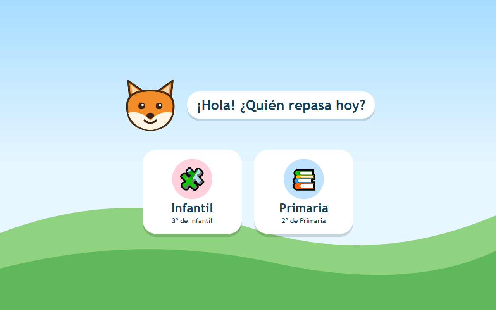

# Repasitos

Web para repasar jugando las materias de 3º de Infantil y 2º de Primaria.

**Web publicada:** <https://onzebol.github.io/repasitos/>



## Perfiles

| Perfil | Curso | Notas |
|--------|-------|-------|
| Infantil | 3º de Infantil (5-6 años) | Muy visual, textos mínimos, botones grandes, sin necesidad de leer mucho |
| Primaria | 2º de Primaria (7-8 años) | Lectura sencilla, ejercicios cortos, retroalimentación inmediata |

## Objetivos

- Repasar las materias del curso con ejercicios cortos y atractivos.
- Que cada perfil tenga su espacio con contenido adaptado a su nivel.
- Que funcione en tablet y ordenador, sin instalar nada (publicado en GitHub Pages).

## Tecnologías

Vite + React + TypeScript. Tests con Vitest y Testing Library (desarrollo guiado por tests). Despliegue automático en GitHub Pages con GitHub Actions. Los emojis usan la fuente Noto Color Emoji incluida en la web (sin servidores externos) para verse igual en todos los dispositivos.

## Estructura

```
repasitos/
├── .github/
│   ├── workflows/ci.yml           # Lint y build en cada PR
│   ├── workflows/deploy.yml       # Build y despliegue a Pages al hacer push a main
│   ├── ISSUE_TEMPLATE/            # Plantilla de tarea
│   └── pull_request_template.md
├── docs/                          # Temario, índices de unidades y diseño
├── public/                        # Iconos, manifest y service worker (app instalable)
├── src/
│   ├── main.tsx
│   ├── App.tsx                    # Pantalla de inicio: elegir perfil
│   ├── components/                # Mascot (Repi), Hills, TopBar, ListScreen, Practice, Keypad...
│   ├── infantil/materias.ts       # Materias de 3º de Infantil (datos)
│   ├── primaria/materias.ts       # Materias de 2º de Primaria (datos)
│   ├── primaria/matematicas/      # Unidades y ejercicios de Matemáticas (datos)
│   ├── types.ts, speak.ts         # Tipos compartidos y lectura en voz alta
│   ├── routes.ts                  # Dirección (#/...) ↔ pantalla, para el botón atrás
│   ├── random.ts                  # Azar inyectable (con semilla en los tests)
│   ├── generators.ts, session.ts  # Plantillas de ejercicios y sesiones de 10 sin repetidos
│   ├── test/setup.ts              # Configuración común de los tests (*.test.ts junto al código)
│   └── assets/theme.css           # Tema visual (estilo "mundo de cuento")
├── index.html
├── .nvmrc                         # Node 24 LTS
├── vite.config.ts                 # base: '/repasitos/' para GitHub Pages
├── README.md
└── CLAUDE.md
```

## Instalar en el móvil o la tablet

La web es instalable (PWA) y funciona sin conexión una vez abierta:

- **Android (Chrome):** menú ⋮ → *Instalar aplicación* (o *Añadir a la pantalla de inicio*).
- **iPhone y iPad (Safari):** botón Compartir → *Añadir a pantalla de inicio*.

Cuando se publica una versión nueva, la app instalada muestra un botón **🔄 Actualizar**; al pulsarlo se recarga con los cambios.

## Desarrollo

```bash
npm install
npm run dev       # servidor local
npm run build     # compila a dist/
npm run lint
npm test          # tests (una vez)
npm run test:watch  # tests vigilando cambios
```

## Publicación

Repositorio público en GitHub. En *Settings → Pages* hay que elegir **Source: GitHub Actions**; después cada push a `main` publica la web en <https://onzebol.github.io/repasitos/>.

## Flujo de trabajo

Las tareas se anotan como issues (con imagen aclaratoria cuando haga falta). Cada issue se trabaja en una rama y una PR en borrador; el CI (lint y build) debe pasar y, tras la revisión, el merge a `main` publica la web. Detalle en `CLAUDE.md`.

## Documentación

- `docs/temario.md`: temario de los dos cursos, fuentes y tareas pendientes.
- `docs/matematicas-2-primaria.md`, `docs/lengua-2-primaria.md`, `docs/conocimiento-del-medio-2-primaria.md`: índices de unidades de 2º de Primaria.
- `docs/diseno.md`: decisiones de diseño y bocetos (`docs/diseno/`).

## Estado

**Hecho**
- Icono de la app (Repi) y web instalable en el móvil, también sin conexión.
- Pantalla de inicio y pantallas de materias con el estilo elegido (mundo de cuento); emojis con la fuente Noto Color Emoji incluida en la web, iguales en todos los dispositivos; flechas de volver y siguiente dibujadas en SVG; página `#/iconos` (solo por dirección) con los iconos que usa la aplicación, para qué sirven y los que se pueden usar; Infantil: materia Números (primeros temas: Contar tocando, ¿Cuántos hay?, Las cifras y trazo guiado de las cifras 0-9 con el dedo; la hoja de trazos sigue en `#/trazo`, solo por dirección); las materias sin contenido se ven desactivadas (#10).
- Navegación con el botón atrás del navegador y del móvil (la pantalla vive en la dirección `#/…`).
- Materias confirmadas y temario de 2º de Primaria.
- Matemáticas de 2º, unidades 1 y 2: ejercicios aleatorios, cada sesión trae 10 distintos y "Repetir" empieza otra. Tipos de ejercicio: elegir, escribir un número y sumar o restar en columna (con llevada opcional).

**Pendiente**
- Matemáticas de 2º, unidades 3 a 9 (una issue por unidad); la siguiente es la unidad 3. Las demás unidades salen como "Muy pronto".
- El resto de materias de 2º de Primaria (Lengua, Conocimiento del medio, Inglés, Música): abren "¡Muy pronto!".
- Todo el perfil de Infantil, empezando por Números: antes hay que concretar el temario (lectoescritura y números de 3º de Infantil).
- Averiguar el método del colegio y conseguir el texto del Decreto 41/2022.
- Diseño: estilo propio de Infantil, audio y pruebas en tablet real.
